# pwn-broker

Keeps a box's targets, notes, creds and tools in order

<picture>
  <source media="(prefers-color-scheme: dark)" srcset="docs/assets/panel-dark.svg">
  
</picture>

<sub>Some of the lines of a real session: each command and the `ok` lines that go with the folder beside it. The launch checks, the questions, and the `/etc/hosts` and ping lines are left out. On the right, the box's folder as each step leaves it, with only the lists the credential fills; finish keeps the folder unless told to remove it.</sub>

```sh
curl -fsSL https://github.com/Real-Fruit-Snacks/pwn-broker/releases/latest/download/install.sh | sh
```

Run it as the user who will use pwn-broker, not with `sudo`; it uses `sudo` only to create `/opt/pwn-broker`, when it has to. It downloads one release file from this repository and checks it against its SHA-256 in `SHA256SUMS.txt`. Then it puts the app and its own Python in `/opt/pwn-broker` and adds one PATH line to `~/.zshrc`, and to `~/.bashrc` if you have one. It needs `sh`, `tar`, `gzip`, `sha256sum` and `curl`, and no Python from the machine. x86_64 Linux with glibc only. Run it again to upgrade.

No network on the Kali machine: copy `pwn-broker-<version>-linux-x86_64.tar.gz` and `install.sh` from the [latest release](https://github.com/Real-Fruit-Snacks/pwn-broker/releases/latest) across and run `sh install.sh --from pwn-broker-<version>-linux-x86_64.tar.gz`. It prints the file's SHA-256 for you to compare with the release page, and contacts nothing. The [guide](docs/guide.md#install-and-upgrade) has the options, how to build a release file from a checkout, and what the install trusts.

I solve Hack The Box machines and want each one kept in order the way an engagement would be. Without that, a box leaves scan output, notes, credentials and downloaded tools scattered across the machine, and nothing records which box any of it belonged to. So I launch `pwn-broker` when I start a box: it asks a few questions, builds the workspace, opens my notes in vim, and stays open as a prompt for the whole session. When the box is done it packs everything into one archive and takes its tools off again. It is for Kali Linux with a desktop session, run by the user who installed it.

## What a box looks like

`pwn-broker new`, then `cred add` and `finish` at the prompt:

```text
$ pwn-broker new
New box
  box name     > forest
  platform     [htb] > 
  date         [2026-11-14] > 
  os           > windows
  difficulty   > easy

  add a target? [Y/n] > 

Target 1
  ip           > 10.10.10.161
  hostname     > forest.htb.local
  scope        [external] > 
  name         [forest.htb.local] > dc01

  ok    target dc01 created

  add another? [y/N] > 

  add dc01's hostnames to /etc/hosts? [Y/n] > 

  ok    /etc/hosts updated
        10.10.10.161 forest.htb.local
  ok    10.10.10.161 answered in 43 ms
  ok    box forest created

forest/dc01 > cred add

  ok    cred 1 saved, found on dc01
  ok    lists updated: 1 username, 1 password, 1 pair

forest/dc01 > finish

  box      forest (htb), started 2026-11-14
  targets  1
  files    14
  archive  /home/kali/pwn-broker/wrapped/2026-11-14_htb_forest.finished.tar.gz
  hosts    1 line to remove from /etc/hosts

  finish this box? [y/N] > y

  ok    archive /home/kali/pwn-broker/wrapped/2026-11-14_htb_forest.finished.tar.gz
  ok    removed 1 line from /etc/hosts
```

Left out: the version line and the launch checks above `New box`, the `New credential` heading and the six questions `cred add` asks, and finish's last question, whether to remove the working folder, with the `ok    removed <folder>` line that follows it. The lines are what the app's code printed, run with stand-ins for the ping, `/etc/hosts` and the note's terminal, and with the paths a user called kali would see.

## What's in it

- **Boxes and targets.** `pwn-broker new`, `import <file>` and `resume [name]`. A box gets a folder under `~/pwn-broker/active/`, each target a folder with `scans/`, `loot/`, `exploits/` and the rest, and one prompt runs for the whole session. Each new target with an IP is pinged once. [Guide](docs/guide.md#boxes-and-targets)
- **The note.** `notes.md` in vim, in a window of its own: the box's details at the top, redrawn when the targets change, and a fold per target. [Guide](docs/guide.md#the-note)
- **Credentials.** Kept exactly as typed, in one list per box. `lists/` is rebuilt from them, so other tools can read `usernames.txt`, `userpass.txt`, `hashes.txt` and the rest. [Guide](docs/guide.md#credentials)
- **/etc/hosts.** One line per target, marked with the box ID, kept in step with the target and removed at `finish`. Other lines are never changed. [Guide](docs/guide.md#the-hosts-file)
- **Recording.** `record [target]` in any terminal records that window with a pinned asciinema 3.2.1 and writes a timed text copy beside it, for grep. `replay` plays one back. [Guide](docs/guide.md#recording)
- **VPN.** `vpn start`, `stop`, `status` and `log` for OpenVPN. The `.ovpn` file is copied into the box and never archived. [Guide](docs/guide.md#vpn)
- **Tools.** `tool install` from [`pwn-shop`](https://github.com/Real-Fruit-Snacks/pwn-shop): kerbrute, pspy, certipy, targetedkerberoast, ligolo-ng, peass-ng, chisel, godpotato and runascs. The Python ones bring their own Python, so Kali's is never used or shadowed. `finish` takes them off again. [Guide](docs/guide.md#tools)
- **Finish, export, import.** `finish` archives the box to `~/pwn-broker/wrapped/` and closes it, `export` writes a snapshot and keeps working, and `pwn-broker import` unpacks either. [Guide](docs/guide.md#finish-export-and-import)

`help` at the prompt lists every command; the [guide](docs/guide.md#every-command) has them all in one table.

## Tested on

- The unit suite on Windows 11 under Python 3.13, and on Ubuntu 24.04 in CI under Python 3.11, 3.12, 3.13 and 3.14 and once more as root, with warnings treated as errors
- One whole box in the official Kali image in CI (Kali 2026.3, as root): installed from the release file with the container's network off, then new box to `finish` and `import`, with a real OpenVPN and `tun0`, under a virtual display with `xterm`
- An install in a bare `debian:stable-slim` container with no Python and no network
- Every command by hand in Kali 2026.2 under WSL 2, as root, with Kali's own qterminal, including building the release file there and upgrading an install made by the old installer
- The published `v0.1.0` there too: the install line above, then a box with all six tools installed from the published index, each started once, and taken off again by `finish`
- And once more there as a normal user whose `sudo` asks for a password: the install line, then a box with `/etc/hosts`, the VPN, three tools, a recording, files made with `sudo` and `finish`
- *Not* tested: a full Kali desktop session; a real Hack The Box connection

[docs/tested.md](docs/tested.md) is the full record: counts, versions, dates and what each run checked.

## Known issues

- x86_64 Linux with glibc only. On any other machine the installer stops and says so.
- The app's Python and its OpenSSL are as new as the release, not as Kali; a fix to them reaches you only in a new release. They take about 100 MB more on disk.
- Close pwn-broker before you upgrade. The installer replaces `app/` and `python/` under a running prompt, and does not check.
- On a terminal that hosts all its windows in one process, such as gnome-terminal, `finish` closes the note's vim but cannot close its window.
- Nothing is signed. `SHA256SUMS.txt` comes from the same release as the file it checks, and the tool index that every zip is checked against is not signed either: the checks catch a corrupted download or a swapped zip, not who published them.
- A password typed on a command line in a recorded window is in the recording and the archive. One typed at a hidden prompt is not.
- `quit` leaves the box's `/etc/hosts` lines in place; only `finish` removes them.
- `finish` refuses while a window is recording for the box or one of its tools is running. Exit those first.

The rest of the list is in [docs/tested.md](docs/tested.md#known-limits).

## Configuration

`/opt/pwn-broker/config.toml`, optional. Without it everything uses the defaults. The installer takes `--config <path>` to copy one in.

| Setting | Default | Meaning |
|---|---|---|
| `home` | `~/pwn-broker` | Where `active/`, `wrapped/` and `tools.log` live |
| `copy_to` | not set | A second folder every finished archive and export is also copied to |
| `default_platform` | `htb` | Platform used when a box is created |
| `terminal` | `x-terminal-emulator` | What opens the note window |
| `check_updates` | `true` | Look for a newer release at launch |
| `tools_index` | the published index in `pwn-shop` | A URL, or a folder that holds `index.toml` and the zips it names |

## License

[MIT](LICENSE).
[Project page](https://real-fruit-snacks.github.io/pwn-broker/) · [Guide](docs/guide.md) · [Changelog](CHANGELOG.md) · [Security](SECURITY.md) · [Contributing](CONTRIBUTING.md)
